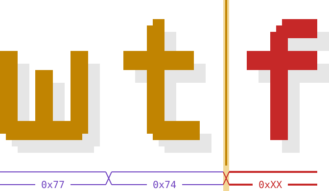
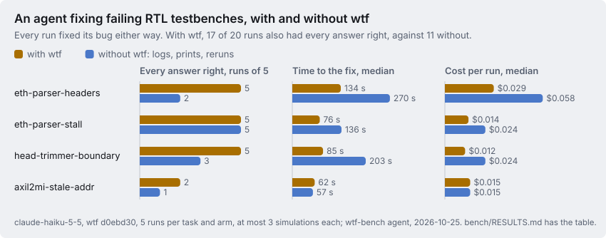

<p align="center">
  <picture>
    <source media="(prefers-color-scheme: dark)" srcset="docs/logo-dark.svg">
    
  </picture>
</p>

<div align="center">

[](https://github.com/xtrollyj00/wtf/actions/workflows/ci.yml)
[](https://codecov.io/gh/xtrollyj00/wtf)
[](https://tdqs.dev/reports/tt1wg8d953)
[](https://github.com/xtrollyj00/wtf/releases/latest)
[](#license)


</div>

**W**aveform **T**erminal **F**rontend: a Vim-like terminal viewer for VCD, FST and GHW waveforms that
decodes AXI, SPI and UART into transactions you can filter, count and measure. It runs where your
simulations run, over ssh and in tmux, and opens no network connections. Also what you say when
the bus goes `X`.

The [site](https://xtrollyj00.github.io/wtf/) has a quick start, recipes and every key.


Signals added from the tree, an AXI4-Lite bus decoded into its writes and reads with their
latency, a search for the cycles where the address waits for ready (mark 2), and a jump from the
list of reads to the one answered with SLVERR, unfolded into its fields. To try it, clone this
repository and run `cp docs/demo.vcd tour.vcd` and `wtf tour.vcd`.

## Features

- **Decoding.** AXI-Stream, AXI4-Lite, AXI4, SPI and UART into records (transfers, frames,
  transactions with their latency, protocol errors), and your own protocols defined in a few
  lines. The records browser filters, sorts and counts them, and `Enter` jumps to one.
- **Search.** `/0x40` finds a value; `/valid && ready && data == 0x40` an expression;
  `/@clk fell(valid) && !past(ready)` a protocol violation, cycle by cycle.
- **Vim-like.** Time is the line axis: `h` / `l` move the cursor, `w` / `b` jump between
  transitions, `gg` / `G` go to the start / end, `:2000ns` goes to a time, `z` / `x` zoom.
  `dd`, `J` / `K`, `r` change the rows, and `u` takes any change back. `Space` opens a menu of
  the rest, every entry with its key. The mouse works too: click to place the cursor,
  Ctrl+wheel to zoom.
- **Signals.** A finder with a preview, a signal tree, groups, buses expanded into bits, structs,
  records and arrays as one row, radixes (hex, binary, decimal, signed, octal, ASCII, float,
  fixed point, and enum names from FST files), computed signals (`data[7:4]`, `{a, b}`).
- **Cursors.** The cursor and up to eight marks, with the time between them on a ruler.
- **Sessions.** What you look at is saved in a TOML file next to the trace and comes back the
  next time. After you rerun the simulation, the window reloads it by itself, decodes included.
- **Display.** Dark and light themes or your own colours, X and Z told apart by shape as
  well as colour, `NO_COLOR`, and plain box drawing or ASCII for fonts and terminals that need
  it (`--glyphs`). `--snapshot` prints a screen as text, for CI logs and bug reports.

## Install

On Linux or macOS (x86_64 or arm64):

```sh
curl -fsSL https://raw.githubusercontent.com/xtrollyj00/wtf/main/install.sh | sh
```

This puts the `wtf` command in `~/.local/bin`, checked against the release's checksum. The
archives are on the [releases page](https://github.com/xtrollyj00/wtf/releases) too. Or build it
from [crates.io](https://crates.io/crates/wtf-wave):

```sh
cargo install --locked wtf-wave
```

On Windows (experimental, Windows 10 1803 or later): take `wtf.exe` from the release's
`wtf-x86_64-pc-windows-msvc.zip`, or `cargo install --locked wtf-wave`. Terminal behaviour is
untested there (spec §18).

## Use

```sh
wtf trace.fst              # or .vcd or .ghw; the format is read from the content
wtf                        # the start screen: recent traces
wtf -S my.session.toml trace.fst
wtf --snapshot 120 trace.fst   # one screen as text, for CI logs and bug reports
wtf --snapshot 120x30 --ansi --keys '?' trace.fst   # in colour, after pressing keys
```

wtf shows what the file holds. A VCD keeps less than an FST: no enum names and no scope types,
so a struct or union is a plain scope.

The first start asks which glyphs your terminal draws well and whether you want dark or light
(`wtf --setup` asks again). Then wtf shows what to do first: `Space f` finds a signal by name,
`a` browses the signal tree, and `Space d d` decodes an interface wtf found in the trace. `?`
shows the keys, `:` takes commands, `:w` saves the session, `q` quits. The
[quick start](https://xtrollyj00.github.io/wtf/get-started/) walks through it on `docs/demo.vcd` (in a clone of this repository).

## For agent users

If you use an AI coding agent, wtf can give it your traces: the same decoders and records,
and it shows you what it found. The [agents page](https://xtrollyj00.github.io/wtf/agents/) has the
full story.

Register the MCP server once, for example with Claude Code:

```sh
claude mcp add wtf -- wtf --mcp
```

A VCD is text, and an agent left to itself reads it with `cat` and `grep`. Claude Code defers an
MCP server's tools until the agent searches for them, which makes that likelier: on NVIDIA's CVDP
debug problems, agents given the failing run's VCD with wtf's tools deferred called wtf in none
of 10 runs. Keep wtf's tools loaded (`ENABLE_TOOL_SEARCH=false` in the environment), and tell the
agent in your project's `CLAUDE.md` or `AGENTS.md`: "Read waveforms (VCD, FST, GHW) with the wtf
MCP server's tools."

Then ask the agent about a trace. It opens it in a workspace of its own and answers
from the decoded values. Asked for failed reads in `docs/demo.vcd`, an agent calls the `command`
tool with `decode bus axilite clock=aclk prefix=s_axi_`, then `records` on `bus.rd` with
`where: "resp != 0"`, and gets:

```
1 of 1 matching, of 2
start	end	delay	addr	data	resp
175ns	205ns	20ns	0x40	0x0	0x2
```

When it has found something, it prepares the rows and puts marks on the events, then `present`s
them in your open wtf window (`:undo` gives you your own view back). With no window open, it writes
a session file for you to open. While it works, your window on the trace shows each step it takes,
and `:follow` shows its workspace as it builds it.

https://github.com/user-attachments/assets/19ea36cd-b8ff-4986-a786-f335e6e31a12

`wtf-bench agent` measures how much it helps: it gives an agent failing RTL testbenches to debug
and fix, with wtf and without it. Every run fixed its bug either way; 17 of 20 runs with wtf also
had every answer right (when and where it went wrong), against 11 of 20 without. The numbers and
how they were taken are in [`bench/RESULTS.md`](bench/RESULTS.md).

<picture>
  <source media="(prefers-color-scheme: dark)" srcset="docs/agents-dark.svg">
  
</picture>

## Before 1.0.0

wtf is young and changes fast. Until 1.0.0 nothing is kept backward compatible: session files,
the MCP tools' arguments, keys and commands change whenever a better design turns up, and the
old form stops working. A commit that breaks something says so (`feat(core)!: ...`, with a
`BREAKING CHANGE:` note on what to do instead).

## Documentation

The [site](https://xtrollyj00.github.io/wtf/) has a quick start on `docs/demo.vcd`, how wtf works,
recipes, every key and command, configuration, the agent setup and its reference, and
troubleshooting.

The design is in [`spec/`](spec/README.md), one file per topic: the keys, commands, search,
sessions, the MCP server and the decoders. [`ROADMAP.md`](ROADMAP.md) says what comes next;
the shortcuts taken so far are the [`known-limit` issues](https://github.com/xtrollyj00/wtf/issues?q=is%3Aissue+label%3Aknown-limit).

## Contributing

Bug reports, ideas for the screen, agent benchmark tasks and speedups are all welcome:
[`CONTRIBUTING.md`](CONTRIBUTING.md) says how.

## License

Licensed under either of [Apache License, Version 2.0](LICENSE-APACHE) or
[MIT license](LICENSE-MIT) at your option.

Unless you explicitly state otherwise, any contribution intentionally submitted for inclusion in
wtf by you, as defined in the Apache-2.0 license, shall be dual licensed as above, without any
additional terms or conditions.
