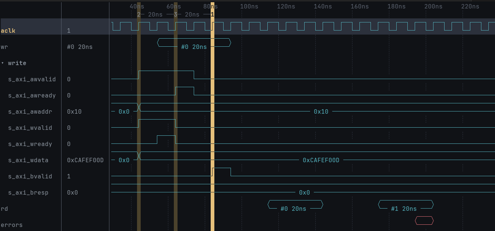
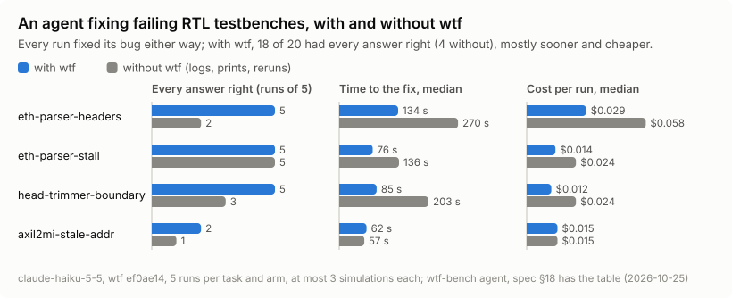

# wtf

**W**aveform **T**erminal **F**rontend: a Vim-like terminal viewer for VCD and FST waveforms,
with an MCP server so AI agents can debug a trace with you. Also what you say when the bus goes
`X`.



An AXI4-Lite bus decoded into transactions (`wr`, `rd`, each with its latency) and protocol
errors, next to the handshake it came from. Marks 2 and 3 and the cursor sit on the valid, the
ready and the response, with the time between them on the ruler. Try it:
`wtf docs/demo.vcd`.

## Features

- **Vim-like.** Time is the line axis: `h` / `l` move the cursor, `w` / `b` jump between
  transitions, `gg` / `G` go to the start / end, `:2000ns` goes to a time, `z` / `x` zoom.
  Viewing is the default; changing what is shown is a separate Edit mode (`i`).
- **Signals.** A searchable signal tree, groups, buses expanded into bits, radixes (hex, binary,
  decimal, signed, octal, ASCII, float, fixed point, and enum names from FST files), computed
  signals (`data[7:4]`, `{a, b}`).
- **Search.** `/0x40` finds a value; `/valid && ready && data == 0x40` an expression;
  `/@clk fell(valid) && !past(ready)` a protocol violation, cycle by cycle.
- **Cursors.** The cursor and up to eight marks, with the time between them on a ruler.
- **Decoding.** AXI-Stream, AXI4-Lite, AXI4, SPI and UART into records (transfers, frames,
  transactions with their latency, protocol errors), and your own protocols defined in a few
  lines.
- **Sessions.** What you look at is saved in a TOML file next to the trace and comes back the
  next time. After you rerun the simulation, `:e` reloads it.
- **AI agents.** `wtf --mcp` lets an agent open your trace, find and decode what matters, and
  show its evidence in your window.

## Install

With a recent stable Rust (`rustup update`):

```sh
cargo install --git https://github.com/xtrollyj00/wtf wtf-wave
```

This installs the `wtf` command. Linux and macOS; Windows is not supported.

## Use

```sh
wtf trace.fst              # or .vcd; the format is read from the content
wtf -S my.session.toml trace.fst
wtf --snapshot 120 trace.fst   # one screen as text, for CI logs and bug reports
```

At first the screen is empty: press `i` to add signals (`/` searches, `Space` marks, `Enter`
adds), `Esc` to go back to viewing, `?` for the keys of the mode you are in, `:` for commands,
`:w` to save the session, `q` to quit.

## With an AI agent

Register the MCP server once, for example with Claude Code:

```sh
claude mcp add wtf -- wtf --mcp
```

Then ask the agent about a trace. It opens it in a workspace of its own and answers with
evidence, not guesses. Asked for failed reads in `docs/demo.vcd`, an agent calls the `command`
tool with `decode bus axilite clock=aclk prefix=s_axi_`, then `records` on `bus.rd` with
`where: "resp != 0"`, and gets:

```
1 of 1 matching, of 2
start	end	delay	addr	data	resp
175ns	205ns	20ns	0x40	0x0	0x2
```

When it has found something, it prepares the rows and puts marks on the events, then `present`s
them in your open wtf window (`:undo` gives you your own view back). With no window open, it writes
a session file for you to open. `wtf --attach` lists what agents have open.

How much it helps is measured, not claimed: `wtf-bench agent` gives an agent failing RTL
testbenches to debug and fix, with wtf and without it (logs, prints and reruns only). Without it
the agent still fixed every bug, as these bugs show in the code; with it, it could more often
also say when and where things went wrong, in fewer simulation runs, sooner and for less. The numbers and how they were taken are in
[spec §18](spec/18-deferred.md).

<picture>
  <source media="(prefers-color-scheme: dark)" srcset="docs/agents-dark.svg">
  
</picture>

## Documentation

The design is in [`spec/`](spec/README.md), one file per topic: the keys, commands, search,
sessions, the MCP server and the decoders. [Known limits](spec/18-deferred.md#known-limits)
lists the shortcuts taken so far. [`ROADMAP.md`](ROADMAP.md) says what comes next.

## Contributing

Issues and pull requests are welcome. Behaviour is specified in `spec/` first, so a change that
alters what wtf does changes the spec with it. Commit messages follow
[Conventional Commits](https://www.conventionalcommits.org/). `cargo test` and
`cargo clippy --all-targets` should pass. [`CLAUDE.md`](CLAUDE.md) has the commands and the
architecture, for people and agents alike.

## License

Licensed under either of [Apache License, Version 2.0](LICENSE-APACHE) or
[MIT license](LICENSE-MIT) at your option.

Unless you explicitly state otherwise, any contribution intentionally submitted for inclusion in
wtf by you, as defined in the Apache-2.0 license, shall be dual licensed as above, without any
additional terms or conditions.
